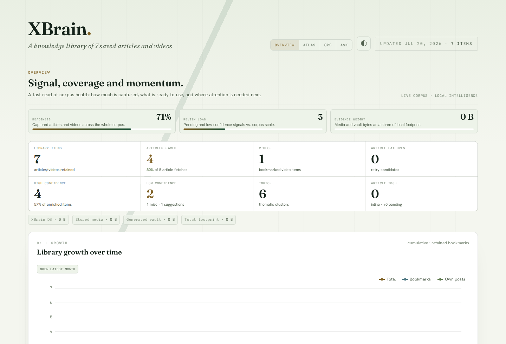
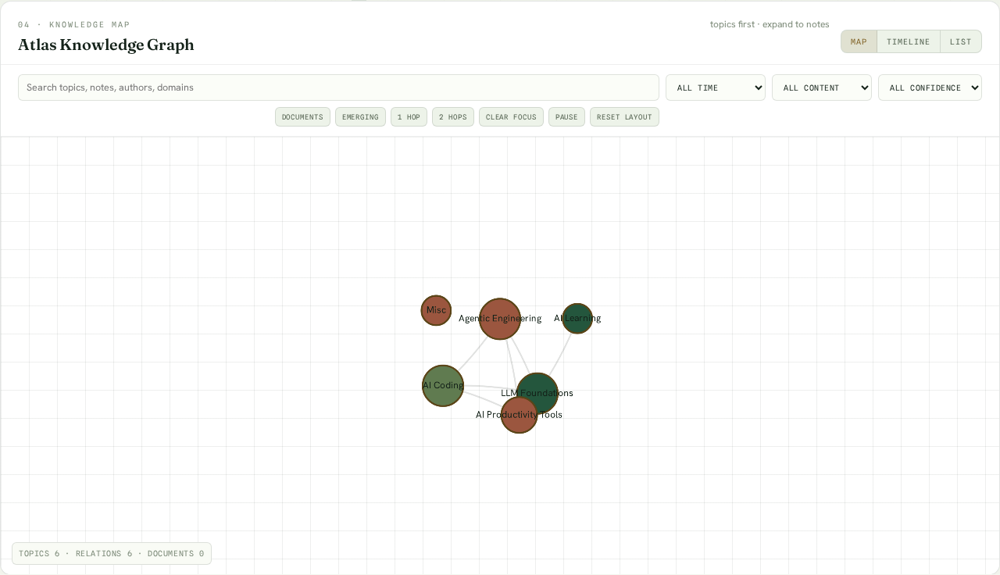
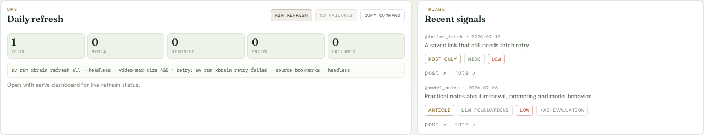
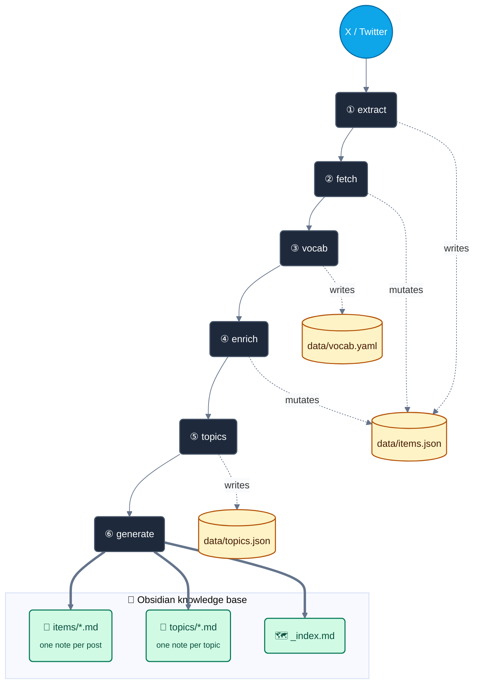
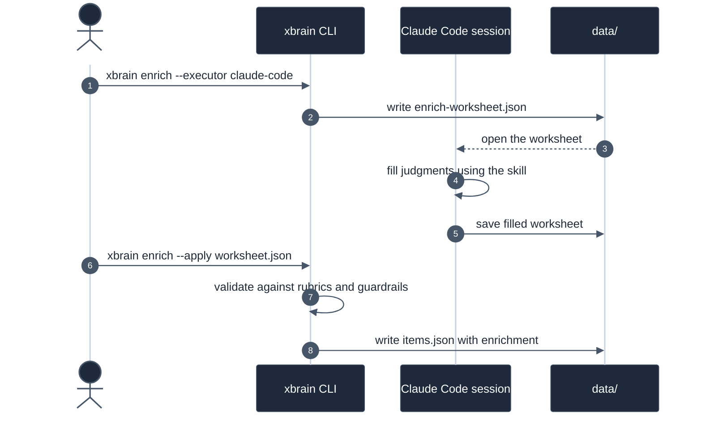
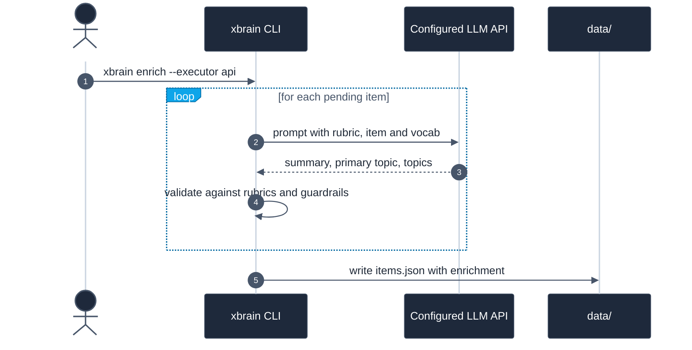
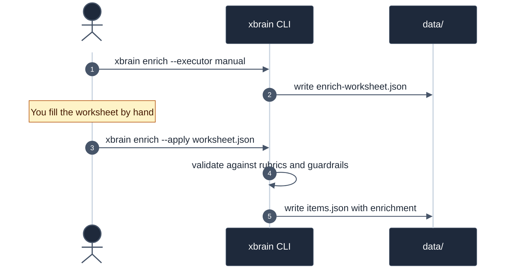

# XBrain (`xbrain`)


> Your saved X articles and videos, turned into a second brain.

You bookmark a sharp thread, a research paper, a tool someone shipped over the
weekend — and a small part of your brain checks a box: *handled, I have that
now.* Then you never see it again. A bookmark folder is not a library; it is a
graveyard with good intentions.

XBrain digs it up. It extracts your X bookmarks that contain articles or videos, stores them
as structured JSON, and generates a layered, cross-linked Obsidian wiki you can
actually navigate, search and think with — in the same vault, the same graph,
as the notes you already keep.

It runs locally. The LLM work needs **no paid API** — a Claude Code session does
it through a worksheet hand-off (see [Execution modes](#execution-modes)).

---

## Table of contents

- [Why XBrain](#why-xbrain)
- [What you get](#what-you-get)
- [Screenshots](#screenshots)
- [Quick start](#quick-start)
- [Prerequisites](#prerequisites)
- [Installation](#installation)
- [Authentication](#authentication)
- [Configuration](#configuration)
- [The pipeline](#the-pipeline)
- [Commands](#commands)
- [Execution modes](#execution-modes)
- [Snapshots & safety](#snapshots--safety)
- [How it works](#how-it-works)
- [Project structure](#project-structure)
- [Development](#development)
- [Responsible use](#responsible-use)
- [Documentation](#documentation)

---

## Why XBrain

A personal knowledge base — a "second brain" — captures everything you
**produce**: your notes, your drafts, your decisions.

But it is worthless if it does not capture what you **consume** — the articles
you read, the threads you save, the posts you write on a platform that is not
your vault. That gap is real, and it is shaped exactly like everything you found
worth keeping.

Months of bookmarks are not noise. Every one was a decision that *this is worth
coming back to* — a quiet, honest signal about what you care about and how your
thinking moves. Left inside X, that signal is just a pile you walk away from.
XBrain pulls the consumption side of your brain into the same place as the
production side, so your bookmarks and your notes finally link to each other.

**Who it is for** — anyone who uses X as a feed of things worth keeping and
already thinks in a tool like Obsidian. If you have a bookmark graveyard of your
own, you already have the raw material.

---

## What you get

A **three-layer wiki** inside your Obsidian vault, plus an interactive knowledge
workspace. Start in Library to search and filter what you saved, move to Atlas
to follow relationships, or use Analytics to understand composition and quality.

All three layers are markdown notes inside a single Obsidian vault, under
`learnings/x-knowledge/`. Each layer is denser than the one below it: many
posts → fewer topics → one index.

**Example layout — three notes side by side, as they appear in the vault:**

<table>
<tr>
<th align="center" width="33%">📄 Items</th>
<th align="center" width="33%">📑 Topics</th>
<th align="center" width="34%">🗺️ Index</th>
</tr>
<tr>
<td align="center"><sub>one per saved post · scales with your X corpus</sub></td>
<td align="center"><sub>one per topic · ~30 by default (configurable)</sub></td>
<td align="center"><sub>one note · the map</sub></td>
</tr>
<tr>
<td valign="top">

```text
┌──────────────────┐
│ Code Is Cheap... │
│                  │
│ @codestirring    │
│ tags: ai-coding  │
│                  │
│ ▸ Summary        │
│ ▸ Tweet text     │
│ ▸ Linked article │
│   (fetched in    │
│    full)         │
│                  │
│ Topics:          │
│  [[ai-coding]]   │
│  [[software-..]] │
└──────────────────┘
```

</td>
<td valign="top">

```text
┌──────────────────┐
│ ai-coding (299)  │
│                  │
│ ▸ Overview       │
│   "The arc from  │
│    vibe coding   │
│    to agent      │
│    orchestration │
│    over 16 mo."  │
│                  │
│ ▸ Primary (103)  │
│   - [[post 1]]   │
│   - [[post 2]]   │
│                  │
│ ▸ Also relevant  │
│   (196)          │
└──────────────────┘
```

</td>
<td valign="top">

```text
┌──────────────────┐
│ XBrain           │
│                  │
│ ▸ Summary        │
│   1884 items     │
│   1123 bookmarks │
│   761 own tweets │
│                  │
│ ▸ Topics         │
│   [[ai-coding]]  │
│         (299)    │
│   [[ai-industry]]│
│         (225)    │
│   ...            │
└──────────────────┘
```

</td>
</tr>
<tr>
<td valign="top"><sub>The original post, the linked article fetched and stored inline, an LLM summary, and the topics it belongs to.</sub></td>
<td valign="top"><sub>A synthesised essay across every post in this theme — where your thinking started, how it moved — plus links back to every post.</sub></td>
<td valign="top"><sub>Every topic ranked by size, links to everything. Open this first.</sub></td>
</tr>
</table>

### Layer 1 — Items

One note per retained bookmark: the original text, the link, the **linked
article or video fetched and stored inline**, an LLM summary and its topics. A saved link
stops being a URL that will quietly rot and becomes a saved *article*. This now
includes an X long-form **Article you bookmarked directly** (not just one linked
inside a tweet): `extract` detects the Article and threads it into the same fetch
pipeline as any other x.com link. `fetch` then captures the Article as a
**structured, ordered body** — its paragraphs and inline images in the order the
author wrote them; if that structured capture can't be read, it **falls back to
text-only** extraction (no images), exactly as before. [`media`](#commands) then
**downloads those inline images** locally alongside the item's own photos (under
`data/media/<id>/article/`), and [`generate`](#commands) **renders the Article as
a blogpost** — the body prose with its inline images embedded in the author's
order (the text-only fallback still renders the article text).

A **bookmarked video** gets the same treatment: run [`digest-video`](#commands)
and XBrain stores the raw transcript as a separate reference artifact and
attaches only an executive summary to the item. It prefers captions/text tracks
from X; when they are absent it can stream the MP4 only inside a private temp
directory, transcribe it, and delete the media bytes. That summary flows through
the *same* `enrich -> topics -> generate` pipeline as an article. XBrain never
stores MP4, audio, frames or video-derived image files.

*Example:*

```markdown
---
id: "2010040815176085621"
source: bookmark
author: codestirring
tags: [x-knowledge, ai-coding, software-engineering, ai-economy]
---

# Code Is Cheap Now. Software Isn't.

Links an article arguing that code itself has become cheap but software has
not: Claude Code and Opus 4.5 democratise software creation and open the era
of personal, throwaway software...

**Topics:** [[ai-coding]] · [[software-engineering]] · [[ai-economy]]

## Tweet
Code Is Cheap Now. Software Isn't.  https://t.co/J9m5RzQNbW

## Content: Code Is Cheap Now. Software Isn't.
<the full text of the linked article, fetched and stored inline>
```

Everything above the `xbrain:generated` marker is regenerated on every run;
anything *you* write below it is preserved.

> Set `[output] topic_style = "hashtag"` in `config.toml` to render the
> in-body `**Topics:**` line as `#ai-coding #software-engineering` instead of
> wikilinks — useful if you navigate primarily via Obsidian's tag pane. The
> frontmatter `tags:` are native Obsidian tags in either mode.

### Layer 2 — Topics

The layer that makes XBrain more than a tidy backup. **A topic page is not a
list of links — it is an essay.** XBrain reads every post filed under a theme
and writes one synthesis: where the thinking started, how it moved, what it kept
circling back to. Then it lists the posts — the ones the topic is *about*
(primary), and the ones that merely touch it (also-relevant).

*Example:*

```markdown
---
topic: ai-coding
posts: 299
primary_posts: 103
---

# ai-coding

> Building software with AI: vibe coding, the shift in how code gets written,
> and AI as a pair-programmer.

## Overview

The largest topic in the corpus, narrating — almost month by month — how the
craft of programming has been transformed under the pressure of AI. The arc
is sharp: from autocomplete and vibe coding in 2025 to agentic engineering
in 2026...

## Key notes
- ...

## Primary posts (103)
- `2026-01-10` · @codestirring · [[items/...|Code Is Cheap Now. Software Isn't.]]

## Also relevant (196)
- ...
```

The overview is plain prose — the LLM writes the synthesis, the *code* writes
every link (see [How it works](#how-it-works)), so regenerating never breaks one.

### Layer 3 — Index

`_index.md` is the map — the corpus counts and every topic ranked by size.
`log.md` is the full chronology.

*Example:*

```markdown
# XBrain

## Summary
- Total items: 1884
- Bookmarks: 1123 · Own tweets: 761
- Enriched: 1884

## Topics
- [[ai-coding]] (299)
- [[ai-industry]] (225)
- [[ai-and-work]] (220)
  ...
```

The markdown is **derived and disposable** — regenerate it any time. The source
of truth is `data/items.json`.

> The examples above are shown in English for clarity. Today the output language
> (summaries, overviews, section headers like "Topics" / "Content") is fixed by
> the rubrics in `src/xbrain/rubrics/` — Spanish on the live system; a config
> parameter to switch languages is on the roadmap ([#16](https://github.com/VGonPa/xbrain/issues/16)).

---

## Screenshots

The screenshots below use synthetic demo data, not a real XBrain corpus.







The dashboard is organized around four low-friction workspaces:

- **Library** combines metadata search, served full-note search, topic/content/
  confidence/author/domain/date filters, useful quick views, sorting, and a
  document drawer.
- **Atlas** puts the mind map first and adds a publication/acquisition timeline
  plus a keyboard-friendly Documents view. Relation width can represent either
  affinity or shared-document volume.
- **Analytics** recalculates every KPI, chart, and table from the same selection.
  Clicking a chart segment applies a filter that is immediately visible in
  Library and Atlas.
- **Operations** owns refresh/retry controls, failure evidence, and storage.
  **Ask** is a global drawer that can use either the whole library or the current
  filtered selection.

Filter state is stored locally and reflected in the URL, so analytical views can
be bookmarked or shared between your own devices. Open the generated file
directly for metadata search; use `xbrain serve-dashboard` for full-note search,
Ask, note viewing, and operational actions.

---

## Quick start

```bash
# 1. Install
uv venv
uv pip install -e ".[dev]" --index-url https://pypi.org/simple
uv run playwright install chromium

# 2. Configure
cp config.toml.example config.toml      # then edit: vault path + X handle

# 3. Authenticate (log in to X in Chrome first)
uv pip install browser-cookie3 --index-url https://pypi.org/simple
.venv/bin/python scripts/import_chrome_session.py
# → "auth_token: OK"  means you are ready

# 4. Build the wiki
uv run xbrain sync       # extract + fetch + generate
uv run xbrain status     # see the counts
```

`sync` builds the mechanical layers. The LLM layers (`vocab`, `enrich`,
`topics`) are run explicitly — see [The pipeline](#the-pipeline).

> **New to XBrain?** The [**Tutorial**](docs/tutorial.md) walks through the whole
> thing end-to-end — pull your posts, add topics, download + describe media, and
> digest a bookmarked talk — with the output you should see at each step.

---

## Prerequisites

| Requirement | Version | Notes |
|-------------|---------|-------|
| Python | 3.12+ | |
| [`uv`](https://docs.astral.sh/uv/) | latest | Package manager and runner. |
| Chromium | — | Installed via `uv run playwright install chromium`. |
| An Obsidian vault | — | Or any folder — XBrain just writes markdown. |
| An X account | — | Yours. XBrain reads *your* bookmarks and tweets. |
| `NANOGPT_API_KEY` | — | **Optional.** Needed when `[llm].provider = "nanogpt"` and an API-backed LLM command runs. |
| `ANTHROPIC_API_KEY` | — | **Optional.** Needed only when `[llm].provider = "anthropic"`. |
| `FIRECRAWL_API_KEY` | — | **Optional.** Fallback fetcher for JavaScript-heavy pages. |

No API key is required for the default worksheet flow: the default execution
mode uses a Claude Code session or manual worksheet and costs nothing.

---

## Installation

```bash
uv venv
uv pip install -e ".[dev]" --index-url https://pypi.org/simple
uv run playwright install chromium
```

The `[dev]` extra also installs the quality-gate tools (`poe`, `ruff`, `mypy`
and the rest). `--index-url https://pypi.org/simple` is only needed if your
machine has a private package index configured.

---

## Authentication

XBrain needs a logged-in X session, stored at `auth/storage_state.json` (Playwright
format, git-ignored). The reliable path is **importing cookies from a browser you
are already logged in to** — pick the one that matches your browser:

```bash
uv pip install browser-cookie3 --index-url https://pypi.org/simple

# You use Chrome — log in to x.com in Chrome, then:
.venv/bin/python scripts/import_chrome_session.py

# You use Safari — log in to x.com in Safari, then grant your terminal
# "Full Disk Access" (System Settings → Privacy & Security), then:
.venv/bin/python scripts/import_safari_session.py
```

A successful import prints `auth_token: OK`. Re-run it whenever the session
expires (X sessions are short-lived).

> `xbrain login` (an in-app Playwright login) also exists, but it is unreliable
> with accounts that sign in through Google/SSO — Google blocks the automated
> browser. The cookie import is the recommended path.

---

## Configuration

Copy `config.toml.example` to `config.toml` (git-ignored) and edit:

```toml
[paths]
vault = "/absolute/path/to/your/obsidian/vault"
output_subdir = "learnings/x-knowledge"   # wiki folder, relative to the vault
data_dir = "data"                         # JSON store, relative to the repo

[drive]
enabled = false                           # false = local, true = Google Drive
cache_dir = ".xbrain-cache/google-drive"  # local working copy when enabled
credentials_path = "auth/google_drive_credentials.json"
token_path = "auth/google_drive_token.json"

[email]
enabled = false                           # notify after Drive-backed updates
recipient = "you@example.com"
sender = ""                               # or XBRAIN_EMAIL_FROM

[snapshots]
auto_prune_keep_last = 25                 # keep newest automatic snapshots; 0 disables

[x]
handle = "your_handle"                    # without the @

[llm]
provider = "nanogpt"                      # nanogpt | anthropic
base_url = "https://nano-gpt.com/api/v1"  # NanoGPT-only API base URL
model = "zai-org/glm-5.2"                 # text model for enrich/vocab/topics
vision_model = "xiaomi/mimo-v2.5"         # image model for describe

[enrich]
executor = "claude-code"                  # claude-code | api | manual

[vocab]
target_count = 45                         # how many topics to induce

[topics]
resynth_threshold = 25                    # re-synthesise an overview after N new posts

[output]
language = "English"                      # English | Spanish
topic_style = "wikilink"                  # wikilink | hashtag (in-body Topics: line)
```

| Section | Key | Default | Purpose |
|---------|-----|---------|---------|
| `[paths]` | `vault` | — | Absolute path to your Obsidian vault. |
| `[paths]` | `output_subdir` | — | Wiki folder inside the vault. |
| `[paths]` | `data_dir` | — | JSON store, relative to the repo. |
| `[drive]` | `enabled` | `false` | When `true`, XBrain reads/writes a local cache and syncs it with Google Drive. When `false`, everything stays local. |
| `[drive]` | `root_folder_id` | — | Google Drive folder selected by `xbrain drive select-root <folder-id>`. Required only when Drive is enabled. |
| `[drive]` | `cache_dir` | `.xbrain-cache/google-drive` | Local working copy used by Drive mode. |
| `[drive]` | `credentials_path` | `auth/google_drive_credentials.json` | OAuth desktop-client JSON from Google Cloud Console. |
| `[drive]` | `token_path` | `auth/google_drive_token.json` | Local user token created by `xbrain drive login`. |
| `[email]` | `enabled` | `false` | Send an email after `refresh-all` / `sync`, only when Drive mode is also enabled. |
| `[email]` | `recipient` | `""` | Notification recipient. Required when email notifications are enabled. |
| `[email]` | `sender` | SMTP username | Notification sender address. Secrets stay in `.env` / environment. |
| `[snapshots]` | `auto_prune_keep_last` | `25` | Keep the newest N automatic snapshots after destructive runs. Manual snapshots are preserved. `0` disables automatic pruning. |
| `[x]` | `handle` | — | Your X handle, no `@`. |
| `[llm]` | `provider` | `nanogpt` | API LLM provider for all API-backed LLM calls: `nanogpt` or `anthropic`. |
| `[llm]` | `model` | `zai-org/glm-5.2` | Text model used by `enrich`, `vocab` and `topics`. |
| `[llm]` | `vision_model` | `xiaomi/mimo-v2.5` | Vision-capable model used by `describe`. |
| `[llm]` | `base_url` | `https://nano-gpt.com/api/v1` | NanoGPT API base URL. Ignored when `provider = "anthropic"`. |
| `[enrich]` | `executor` | `claude-code` | Default [execution mode](#execution-modes) for the LLM stages. |
| `[vocab]` | `target_count` | `30` | Number of topics the `vocab` stage induces. |
| `[topics]` | `resynth_threshold` | `25` | Post growth that marks a topic overview stale. |
| `[output]` | `language` | `English` | Output language for LLM summaries/overviews AND wiki section headers. `English` or `Spanish`. |
| `[output]` | `topic_style` | `wikilink` | How the in-body `**Topics:**` line is rendered: `wikilink` (`[[slug]] · [[slug]]`) or `hashtag` (`#slug #slug`). Frontmatter `tags:` are unaffected. |
| `[describe]` | `version` | `v1` | Tag persisted on every described image. Bumping invalidates existing descriptions so the next `xbrain describe` re-describes stale entries. |

Switching `[output].language` after the corpus is already enriched is supported
— but does not retroactively translate existing summaries. To convert the
whole corpus to the new language, run `xbrain vocab --regenerate` (it clears
every enrichment; the next `xbrain enrich` re-enriches in the new language) and
`xbrain topics --resynth` (both auto-snapshotted, see
[Snapshots & safety](#snapshots--safety)). Otherwise new items get the new
language while old summaries stay as they were.

Secrets (`NANOGPT_API_KEY`, `ANTHROPIC_API_KEY`, `FIRECRAWL_API_KEY`,
`XBRAIN_SMTP_PASSWORD`) and Google OAuth files (`auth/google_drive_credentials.json`,
`auth/google_drive_token.json`) live in the **environment** or local ignored
files only — never in `config.toml`, never in the repo. For NanoGPT, copy
`.env.example` to `.env` and set `NANOGPT_API_KEY`.

### Google Drive library

Google Drive mode is optional. In local mode (`[drive].enabled = false`),
XBrain behaves as before: `data/` and the generated Obsidian vault are local.
In Drive mode, XBrain uses a local cache for the current run and synchronizes
that cache with the selected Drive folder before and after write commands.
Uploads now happen only after a command succeeds. XBrain also fingerprints the
remote tree before and after the command, refuses to upload over concurrent
Drive changes, and will not mirror an empty or structurally invalid cache.

There is no extra LLM cost. Drive API calls use Google Drive API quota, and the
uploaded files count against your Google Drive storage. If your Google account
runs out of Drive storage, you may need more Google storage; XBrain itself does
not add paid API processing beyond the existing LLM stages.

Drive setup:

```bash
uv run xbrain drive login --port 8766
uv run xbrain drive roots
uv run xbrain drive roots --create xbrain-root
uv run xbrain drive select-root <folder-id>
uv run xbrain drive bootstrap-local
```

On a VPS, forward the OAuth callback port from your phone's SSH client before
running `drive login`:

```bash
ssh -L 8766:127.0.0.1:8766 user@your-vps
uv run xbrain drive login --port 8766
```

Then enable Drive:

```toml
[drive]
enabled = true
```

When enabled, commands such as `xbrain sync` and `xbrain refresh-all` place new
bookmarks, `data/`, downloaded media and generated vault files in the selected
Google Drive folder through the cache sync. `auth/storage_state.json`, `.env`,
Google OAuth credentials and tokens remain local.

Optional email notification:

```toml
[email]
enabled = true
recipient = "you@example.com"
sender = "your-smtp-sender@example.com"
smtp_host = "smtp.example.com"
smtp_port = 587
smtp_starttls = true
smtp_ssl = false
```

Set the SMTP credentials in `.env` or the process environment:

```bash
XBRAIN_SMTP_USERNAME=your-smtp-user
XBRAIN_SMTP_PASSWORD=your-smtp-password
```

XBrain sends the email only after a successful `refresh-all` or `sync`, and only
when both `[drive].enabled = true` and `[email].enabled = true`.

### Video digest policy

`digest-video` never stores MP4/audio, never extracts frames, and never writes
video-derived image files. It uses caption/text-track URLs captured from X when
available. If captions are absent, it may stream the MP4 into a private
temporary directory, optionally extract mono 16k audio there for ASR, keep only
the transcript text, and delete the temporary media bytes. The raw transcript is
a vault reference artifact; only the executive summary flows through `enrich`,
`topics`, the dashboard and Ask XBrain.

Local ASR is used only through the temporary fallback. The normal CLI path still
disables manual MP4 persistence (`download-videos`, `fetch-video`) and visual
video artifacts (`digest-video --frames`, `--vision-model`).

On a Linux VPS, use the bundled faster-whisper wrapper from a separate ASR venv:

```toml
[transcribe]
command = "env XBRAIN_WHISPER_CACHE=/opt/xbrain-asr/models XBRAIN_WHISPER_CPU_THREADS=6 XBRAIN_WHISPER_BEAM_SIZE=1 XBRAIN_WHISPER_DELETE_SOURCE_AFTER_AUDIO=1 /opt/xbrain-asr/bin/python /workspace/projects/xbrain/scripts/xbrain-transcribe-faster-whisper"
model = "small"
timeout_seconds = 7200
```

`digest-video --max-size` is still recommended for long videos. The cap is
enforced from `Content-Length` when present and while streaming bytes to disk.
The `list-videos` size column remains an estimate from X's
`bitrate × duration_millis`, so it can be conservative.

---

## The pipeline

Six stages. `data/items.json` is the hub — every stage reads it, enriches it,
and writes it back. The wiki is generated from it at the end.



Six stages, top to bottom. The chain on the left is the order of execution;
the cylinders on the right are the `data/` files each stage writes; the box
at the bottom is what ends up inside your Obsidian vault — three kinds of
plain markdown notes.

- **`data/items.json`** is the hub. Three stages mutate it (`extract`,
  `fetch`, `enrich`); every later stage reads it.
- **`data/vocab.yaml`** is the closed taxonomy. Read by `enrich` (to assign
  topics from it), `taxonomy-health` (to spot drift and missing topics), `topics`
  (to know which pages to synthesise) and
  `generate` (for the tags).
- **`data/topics.json`** is the synthesised topic overviews. Read by
  `generate`.

`⑥ generate` is the only stage that writes into the vault. It turns
`items.json` into `items/*.md`, `topics.json` into `topics/*.md`, and writes
the `_index.md`. Delete the whole vault and `xbrain generate` rebuilds it
bit-for-bit from `data/`.

| # | Stage | Mechanical / LLM | Writes to | What it does |
|---|-------|------------------|-----------|--------------|
| ① | `extract` | mechanical | `items.json` + `state.json` | Pulls new bookmarks + own tweets from X (incremental — stops at known ids). |
| ② | `fetch` | mechanical | `items.json` | Downloads linked article bodies, expands threads, fetches linked X content. Records structured evidence for broken links. |
| ③ | `vocab` | **LLM** | `vocab.yaml` | Induces the controlled topic taxonomy from the whole corpus. |
| ④ | `enrich` | **LLM** | `items.json` | Per item: a summary + a primary topic + 1-4 topics, all from the taxonomy, plus diagnostic confidence/suggested missing topics. |
| ⑤ | `topics` | **LLM** | `topics.json` | Synthesises each topic page's overview; builds the mechanical post lists. |
| ⑥ | `generate` | mechanical | the Obsidian vault | Renders the three-layer wiki: `items/*.md`, `topics/*.md`, `_index.md`. |

Every stage is **idempotent and incremental** — re-running it only processes
what is new. `vocab --regenerate` is the deliberate exception: it re-induces the
taxonomy and marks every item for re-enrichment.

Use `taxonomy-health` after normal ingestion to decide whether the taxonomy is
drifting. If it reports repeated `misc`, low/unknown confidence or suggested
missing topics, first try the cheaper repair path:

```bash
uv run xbrain enrich --taxonomy-risk
uv run xbrain topics --resynth
uv run xbrain generate
```

Only run `vocab --regenerate` when the health report shows a real pattern that
requires changing the vocabulary itself.

A typical full run:

```bash
uv run xbrain extract
uv run xbrain fetch
uv run xbrain vocab          # → fill the worksheet → xbrain vocab --apply
uv run xbrain enrich         # → fill the worksheet → xbrain enrich --apply
uv run xbrain topics         # → fill the worksheet → xbrain topics --apply
uv run xbrain generate
```

---

## Commands

```bash
uv run xbrain <command> [options]
```

| Command | Description |
|---------|-------------|
| `extract` | Extract retained X bookmarks: articles and videos. Own tweets and plain post-only bookmarks are ignored. `--source tweets` remains as an empty compatibility scope. |
| `import-archive <zip>` | Legacy helper for historical own-tweet imports; not part of the normal retained-library workflow. |
| `fetch` | Download linked article content, expand linked X Article content, then prune non-library items from `items.json`. By default, items whose only previous failures were transient (`timeout`, `dns_error`) are re-fetched automatically; terminal failures (`not_found`, `paywall`, `forbidden`, `js_required`, `empty_content`) stay skipped until `--force`. `--force` re-fetches every external_article source regardless of state. |
| `retry-failed` | Force-retry only retained bookmarks whose linked article/X-article sources failed, then regenerate the vault. This is the same action exposed by the dashboard's retry button for failed bookmarks. |
| `media` | Download X-post photos referenced in `Item.media` **and the inline images of a bookmarked X Article**. Local mode stores bytes under `data/media`; Google Drive mode stores them directly under the generated vault's `_media` directory to avoid duplicate Drive storage. `--limit` is a combined budget; the SUMMARY reports article images separately. Item photos and downloaded Article images render inline in the wiki. `--force`, `--limit N`, `--items <a,b,c>`, `--verbose`. See [Media storage](#media-storage). |
| `describe` | Describe downloaded X-post photos and inline X Article images with `[llm].provider` + `[llm].vision_model`, then feed the prose into `enrich` + `topics`. `--force`, `--limit N`, `--items <a,b,c>`, `--model`, `--batch-size`, `--verbose`. Idempotent — re-runs skip already-described images unless `[describe].version` is bumped in `config.toml`. If a multi-image response is malformed, the batch is retried one image at a time. |
| `refresh-media` | Re-capture X and backfill playable video URL + metadata onto poster-era records. It still does not download video bytes. Re-seeing 0 known items on a non-empty store aborts unless `--force`. `--source bookmarks\|tweets\|all`, `--force`. |
| `download-videos` | Disabled by storage policy. XBrain does not persist MP4. |
| `list-videos` | Read-only catalog of every video referenced in `items.json`, showing both media `STATE` and analysis `DIGEST`. Useful for inspecting what XBrain knows about video bookmarks. Writes nothing. |
| `fetch-video` | Disabled by storage policy. XBrain does not expose a manual MP4 write path. |
| `digest-video` | Video processing without persistent media: use a captured caption/text-track URL when available, otherwise stream MP4 only to a private temp dir, transcribe with `[transcribe].command` (the faster-whisper wrapper extracts temp audio first), delete temp media, store the raw transcript as a reference artifact, create an executive summary with the configured text LLM, and attach that summary as `x_video`. `--frames` and `--vision-model` are disabled; `--max-size` caps only the temporary MP4 fallback; `[transcribe].timeout_seconds` caps the external ASR process. |
| `vocab` | Induce the topic taxonomy. `--executor`, `--apply <file>`, `--regenerate`. |
| `enrich` | Enrich items with a summary + topics. `--executor`, `--apply <file>`, `--taxonomy-risk` to re-enrich only items flagged by taxonomy diagnostics (`misc`, low/unknown confidence, suggested missing topics, or stale content). |
| `taxonomy-health` | Read-only diagnostics for taxonomy drift: `misc` usage, confidence counts, single-topic assignments, unused topics and repeated `suggested_new_topics`. |
| `topics` | Synthesise topic pages. `--executor`, `--apply <file>`, `--resynth`. |
| `generate` | Render the wiki into the vault, including `dashboard.html` and the derived Obsidian Canvas map at `maps/xbrain-map.generated.canvas`. |
| `serve-dashboard` | Serve Library full-text search, Atlas, cross-filtered Analytics, the note viewer, Operations and contextual Ask. Defaults to `127.0.0.1:8765`; mutation/Ask requests require same-origin action headers and expensive endpoints are rate-limited. Keep it behind local access or an authenticated reverse proxy. See [Dashboard production runbook](docs/dashboard-production-runbook.md). |
| `sync` | `extract` + `fetch` + `generate`, in order. |
| `status` | Counts and last-run timestamps. |
| `drive` | Manage Google Drive login, root-folder selection, sync and status. |
| `snapshot` | Manage `data/` snapshots: `create`, `list`, `show`, `restore`, `prune`. See [Snapshots & safety](#snapshots--safety). |
| `diff` | Compare two snapshots (or one snapshot vs. the live `data/`). Surfaces reassigned items, topic growth, overview drift, vocab changes. `--format text\|json`. |
| `login` | Open a browser to log in to X (see [Authentication](#authentication) — prefer the cookie import). |

Every stage accepts `--since` / `--until` (ISO dates) to narrow the date window.
The window is inclusive at both ends: a date-only `--until 2025-12-31` covers the
whole of Dec 31 (up to `23:59:59.999999` UTC). Pass an explicit time
(`--until 2025-12-31T09:00:00`) to cut off mid-day instead.
Run `uv run xbrain <command> --help` for the full option list.

---

## Media storage

`xbrain media` downloads X-post photos **and the inline images of a
bookmarked X Article** and persists the bytes locally. Item photos are then
shown inline in the generated wiki; the downloaded Article images are embedded
in the note by `generate`, in the author's order, as a blogpost.

**Local mode layout**

```
data/
└── media/
    ├── 1234567890/        # one directory per item id
    │   ├── 0.jpg          # one file per photo, indexed by media position
    │   ├── 1.jpg
    │   ├── 2.png
    │   └── article/       # inline images of an X Article (#39), namespaced
    │       ├── 0.jpg      #   so they never collide with the item's photos
    │       └── 1.png
	    └── ...
```

Item photos are stored under `data/media/<item-id>/<index>.<ext>` and Article
inline images under `data/media/<item-id>/article/<n>.<ext>` (both via the
same download engine); the extension matches the format the X CDN sent us
(`.jpg`, `.png`, or `.webp`). `data/` is gitignored — the bytes never enter
the repo.

**Google Drive mode layout**

When `[drive].enabled = true`, media is stored only once, directly in the
generated vault:

```
xbrain-root/
└── vault/
    └── <output_subdir>/
        └── _media/
            └── <item-id>/
                ├── <index>.<ext>
                └── article/
                    └── <n>.<ext>
```

This keeps Obsidian/wiki embeds self-contained while avoiding the previous
`data/media` + `vault/_media` duplication in Google Drive.

**Vault rendering**

`xbrain generate` emits Obsidian wikilink embeds
(`![[_media/<id>/<n>.<ext>]]`) so the vault is fully self-contained. In local
mode it mirrors media into `_media`; in Drive mode `_media` is already the
canonical media directory, so no duplicate copy is made.

**Disk budget (approximate)**

X serves `name=orig` JPEGs typically in the 1-2 MP range, averaging
~300 KB per photo on our corpora. A library of ~2,000 items with roughly
one photo per item lands in the ballpark of 300-500 MB on disk —
comfortably within personal-machine scale. Use `--limit N` to throttle
the first backfill.

**Throttling**

The downloader sleeps 0.5 s between requests by default and uses a
browser-style User-Agent. pbs.twimg.com tolerates that pattern; bursting
from a fresh IP earns a 429.

**Failure handling**

Failures are categorised on the item itself
(`MediaPhotoFailed.failure_reason`):
- `http_4xx`, `format_error` — permanent; only `--force` retries.
- `http_5xx`, `timeout`, `unknown_error` — transient; auto-retried on
  the next `xbrain media` run.

Run `xbrain diff <snapshot>` after a media run to see how many photos
moved from `pending` / `failed` into `downloaded` (or, after `xbrain
describe`, into `described`).

**Vision descriptions**

Once `xbrain media` has the bytes on disk, `xbrain describe` runs every
downloaded X-post photo and inline X Article image through the configured
vision model and stores a short prose description on the entry (transitioning
`MediaPhotoDownloaded` → `MediaPhotoDescribed`).
Descriptions are 1-3 sentences, faithful, in the configured
`output_language`. When the image is a screenshot, slide, code sample,
Markdown snippet, or UI with meaningful visible text, `describe` can also store
that extracted text separately for later processing, but the generated note only
shows the short image description so the article stays readable. Real code or
Markdown blocks that are part of an X Article body render as fenced code blocks
in the article flow. Decorative photos (avatars, reaction memes, abstract
backgrounds) are classified as such and persisted with an empty description so
they introduce no topic noise downstream.

`xbrain enrich` and `xbrain topics` consume the descriptions automatically, on
**both** the API and the worksheet (`claude-code` / `manual`) tracks: post photos
appear as `Images in this post:`, inline Article images appear next to the
linked-article body, and worksheets carry the combined `image_descriptions`
field. Topic-page synthesis sees the flat list of content image descriptions
across the topic's posts on either track. This is how a tweet that is mostly a
screenshot or an Article figure becomes searchable by what the image was
actually about.

These descriptions flow whenever `enrich` / `topics` next run for an
item. To back-fill items that were already enriched *before* the
describe pass (a one-time LLM cost), force the re-run: `xbrain vocab
--regenerate` (clears enrichments) then `xbrain enrich`, and `xbrain
topics --resynth`.

Describe cost depends on the configured provider/model and corpus size; the
default NanoGPT vision model is `[llm].vision_model = "xiaomi/mimo-v2.5"`.
Bump `[describe].version` in
`config.toml` to invalidate stored descriptions when you change the
rubric — the next `xbrain describe` run re-describes stale entries
automatically without `--force`.

**Video media**

A video entry carries the external stream URL, poster `thumbnail_url`, optional
bitrate/duration metadata, and, when X exposes it, caption/text-track metadata.
The normal XBrain library policy is: **never store MP4, audio, frames or
video-derived image files**. Temporary MP4/audio bytes are allowed only inside
`digest-video`'s ASR fallback and are removed before the store/vault is written.

Videos captured before caption metadata landed may need `refresh-media` so XBrain
can re-read the X payload and discover newer video/caption fields. It does not
download video bytes.

```bash
xbrain refresh-media                      # backfill bookmarks + own tweets
xbrain refresh-media --source bookmarks   # bookmarks only
xbrain refresh-media --force              # save even if 0 known items re-seen
```

**`digest-video` - the built-in video transcript path.** It fetches captured
caption/text-track URLs when available. If not, it streams MP4 into a temp dir,
transcribes it with the external ASR command, deletes the media bytes, stores the
raw transcript as a reference artifact, and attaches an executive summary as
`x_video`:

```bash
xbrain digest-video --ids 2068,2069        # dedup handles repeated videos
xbrain digest-video --topic ai             # every ai-topic video
xbrain digest-video --all-pending          # every pending video
xbrain digest-video --all-pending --max-size 500MB  # cap ASR fallback downloads
```

`download-videos`, `fetch-video`, `digest-video --frames` and `--vision-model`
are disabled. `--max-size` applies only to the temporary ASR fallback; caption
tracks do not download video bytes.

---

## Snapshots & safety

Destructive commands (`vocab --regenerate`, `topics --resynth`, `fetch --force`)
**auto-snapshot** `data/` before they touch anything. The snapshot is a complete
copy of `items.json`, `state.json`, `vocab.yaml` and `topics.json` under
`data/snapshots/<UTC-timestamp>-pre-<command>/`, with a `snapshot.json` manifest
capturing counts and the running `xbrain` version. If a re-run produces worse
output, a single `xbrain snapshot restore <name>` brings the previous good
state back.

```bash
xbrain snapshot list                        # newest first
xbrain snapshot create --name pre-rubric-v2 # mark a known-good state
xbrain snapshot restore <name>              # roll back data/ (run `generate` next)
xbrain snapshot prune --keep-last 10        # cap disk use
```

By default, XBrain keeps the newest 25 **automatic** snapshots after each
destructive run and leaves manual snapshots untouched. Change
`[snapshots].auto_prune_keep_last`, or set it to `0` to disable automatic
pruning.

The Obsidian vault is **not** snapshotted — it is fully derived from `data/`
via `xbrain generate`. `restore` rolls back `data/`; you run `xbrain generate`
to rebuild the wiki from it.

After a destructive run, `xbrain diff <pre-snapshot>` shows exactly what
moved — items whose `primary_topic` was reassigned, topic memberships that
grew or shrank, overview text that drifted, and vocab slugs added or
removed. The B side defaults to the live `data/`, so the common case is one
short command. Add `--format json` to pipe the report into `jq` or a CI
gate.

```bash
xbrain diff 2026-05-22T18-30-15Z-pre-vocab-regenerate    # vs. live data/
xbrain diff <snap-a> <snap-b>                            # two named snapshots
xbrain diff <snap-a> --format json | jq '.summary.reassigned_pct'
```

---

## Execution modes

`vocab`, `enrich` and `topics` need an LLM. XBrain never embeds a Claude
subscription token — instead the LLM work is **pluggable**, with three modes,
selected by `--executor` or `config.toml`'s `[enrich].executor`. API-backed
text calls use `[llm].provider` / `[llm].model`; image calls use the same
provider with `[llm].vision_model`.

| Mode | Cost | When you reach for it |
|------|------|----------------------|
| **`claude-code`** *(default)* | None | You have Claude Code open. Day-to-day enrichment. |
| **`api`** | Pay per token through `[llm].provider` | Unattended runs (cron, CI, future `/schedule`). No human in the loop. |
| **`manual`** | None | Spot fixes, hand-curating a few items, fallback when the others fail. |

All three modes end the same way — `xbrain` validates the judgments against the
rubrics and `guardrails.yaml`, then writes them into `data/items.json`. They
only differ in *how the LLM judgment gets produced*.

### Mode 1 — `claude-code` *(default)*

**What it does.** The CLI exports a worksheet (`data/enrich-worksheet.json`).
You open a Claude Code session, the `enriching-x-knowledge` skill (in
`.claude/skills/`) fills the worksheet's judgments using the rubrics. You run
`xbrain enrich --apply` to validate and persist.

**Why this mode exists.** Most XBrain users already have a Claude Code
subscription. Spending another API budget to do the same work is wasteful —
this mode lets the existing subscription do the LLM work at zero extra cost.

**When to use it.** Default for interactive runs. You are at your machine,
Claude Code is open, you want to enrich a batch.



### Mode 2 — `api`

**What it does.** The CLI loops over every pending item, calls the configured
API provider once per item with the rubric, item content and vocab. Each
judgment is validated, then a single store write at the end persists everything.

**Why this mode exists.** The `claude-code` mode needs a human present. A
scheduled job, a cron, or a CI run cannot pop open a Claude Code session.
The `api` mode runs end-to-end with zero interaction — the trade is that
you pay per token.

**When to use it.** Unattended runs. The future `/schedule` integration
([#7](https://github.com/VGonPa/xbrain/issues/7)) builds on this mode.



### Mode 3 — `manual`

**What it does.** Identical worksheet plumbing as `claude-code`, but you fill
the judgments by hand instead of letting an LLM do it.

**Why this mode exists.** Two reasons. First, escape hatch: if the LLM keeps
producing wrong judgments for a corner of the corpus, you can fix those items
yourself without rewriting the rubric. Second, the same worksheet format means
the manual path is the lowest common denominator the system always supports —
no API, no Claude Code, just JSON in / JSON out.

**When to use it.** Spot fixes, corrections, hand-curating a handful of items
that need editorial judgment beyond what the rubric captures.



---

## How it works

> For the full picture — every stage, every artifact, the rubrics, the executors and the invariants — see [ARCHITECTURE.md](ARCHITECTURE.md). The summary below is the 5-minute version.

**One hard rule** runs through the whole design: the **LLM emits only judgment** —
a summary, a topic choice, an overview. It never produces a filename, a wikilink
or any structural identifier. The *code* generates every id and link; a
**mechanical validator** rejects any LLM output that is not pure judgment. This
is why regenerating the wiki never breaks a link.

- **`data/items.json`** is the single source of truth. The markdown wiki is
  derived — safe to delete and regenerate.
- **Your notes are preserved.** Anything you write below the `xbrain:generated`
  marker in an item note survives every regeneration.
- **Broken links are demonstrable.** A failed fetch records the HTTP status, a
  categorised reason and the attempt count — not a vague error.
- **`data/` is git-ignored.** Your bookmarks, tweets and session never leave
  your machine.

The data stores in `data/`:

| File | Role |
|------|------|
| `items.json` | Every item — the source of truth. |
| `state.json` | Extraction cursors (for incremental `extract`). |
| `vocab.yaml` | The induced topic taxonomy. Hand-editable. |
| `topics.json` | The synthesised topic-page overviews. |

---

## Project structure

```
xbrain/
├── src/xbrain/
│   ├── cli.py            # Typer CLI — every command
│   ├── config.py         # config.toml loading
│   ├── models.py         # pydantic data models (Item, Enrichment, Topic, ...)
│   ├── store.py          # JSON load/save for items + topic pages
│   ├── refresh.py        # refresh-media backfill: video media swap + size estimate
│   ├── video_digest.py   # digest-video: captions/temporary ASR -> executive summary
│   ├── video_transcript.py # captions parser + temporary ASR fallback + LLM prompt
│   ├── video_select.py   # list-videos: read-only video catalog (VideoRow)
│   ├── video_media.py    # legacy mp4 downloader internals; manual CLI path disabled
│   ├── video_fetch.py    # ephemeral mp4 fetch internals for ASR fallback
│   ├── extract/          # X extraction (Playwright + GraphQL interception)
│   │   ├── browser.py    #   session / browser context
│   │   ├── graphql.py    #   parse X's internal GraphQL responses
│   │   ├── extractor.py  #   scroll + capture loop
│   │   └── threads.py    #   expand own-tweet threads
│   ├── fetch.py          # external article fetch + Firecrawl fallback
│   ├── fetch_x.py        # fetch linked X tweets / articles
│   ├── archive.py        # import the official X data archive
│   ├── vocab.py          # the `vocab` stage (taxonomy induction)
│   ├── enrich.py         # the `enrich` stage
│   ├── executors/        # the `api` executor (the LLM-judgment seam)
│   ├── worksheet.py      # the enrich worksheet hand-off
│   ├── topic_synth.py    # topic-overview synthesis (api + worksheet)
│   ├── topics.py         # topic-page computation + rendering
│   ├── dashboard.py      # dashboard metrics, Library rows and Atlas payload
│   ├── dashboard_http.py # origin/header and in-process rate-limit primitives
│   ├── validate.py       # the mechanical validator (guardrails)
│   ├── rubrics.py        # load the declarative rubrics + guardrails
│   ├── rubrics/          # rubric-*.md + guardrails.yaml (the processing rules)
│   ├── generate.py       # render item notes + index + log
│   └── notes_io.py       # shared markdown helpers
├── scripts/              # import_chrome_session.py / import_safari_session.py
├── deploy/               # hardened systemd + Nginx production examples
├── tests/                # pytest suite (test-first; one test file per module)
├── config.toml.example   # configuration template
└── pyproject.toml        # deps, tooling, `poe` tasks
```

---

## Development

```bash
uv run pytest -v          # run the test suite
uv run poe check          # the full quality gate (run before any PR)
uv run poe test           # individual gate steps: test, lint, types, ...
```

`poe check` runs ten checks — ruff (lint + format), mypy, bandit, vulture,
interrogate, detect-secrets, deptry, and pytest with coverage. CI runs the same
gate on every pull request. The project is built test-first: every module has a
matching `tests/test_*.py`.

---

## Responsible use

XBrain reads X through X's internal (non-public) endpoints. Use it for personal
purposes, with **your own** X account and **your own** data, at your own risk.
It does not use a paid API by default and it does not redistribute anyone else's
content. The extractor scrolls slowly, with randomised pauses, to be a polite
client. Respect X's Terms of Service.

---

## Documentation

| Document | Description |
|----------|-------------|
| [docs/tutorial.md](docs/tutorial.md) | **Start here** — end-to-end walkthrough from install to a searchable wiki. |
| [docs/atlas-knowledge-graph.md](docs/atlas-knowledge-graph.md) | Atlas data contract, Map/Timeline/Documents controls, shared selection, stable layout persistence, served actions, and Canvas export. |
| [docs/dashboard-style-guide.md](docs/dashboard-style-guide.md) | Design tokens and UX rules for Library, Atlas, Analytics, Operations, Ask, accessibility, and the note viewer. |
| [docs/dashboard-production-runbook.md](docs/dashboard-production-runbook.md) | Hardened production serving, security/rate-limit smoke checks, systemd/Nginx examples, and rollback. |
| [docs/digest-video.md](docs/digest-video.md) | Worked example: turn a bookmarked video caption into transcript + executive summary artifacts. |
| [docs/troubleshooting.md](docs/troubleshooting.md) | Common failures & fixes (auth, PATH, digest-video, iCloud). |
| [ARCHITECTURE.md](ARCHITECTURE.md) | How XBrain is shaped: pipeline stages, artifacts, rubrics, executors, invariants. |
| [CONTRIBUTING.md](CONTRIBUTING.md) | How to contribute — including PRs written with AI agents. |
| [LICENSE](LICENSE) | MIT. |

PRs written with AI agents are welcome, at the same quality bar as any other
code. See [CONTRIBUTING.md](CONTRIBUTING.md).

---

*Last updated: 2026-09-01*
